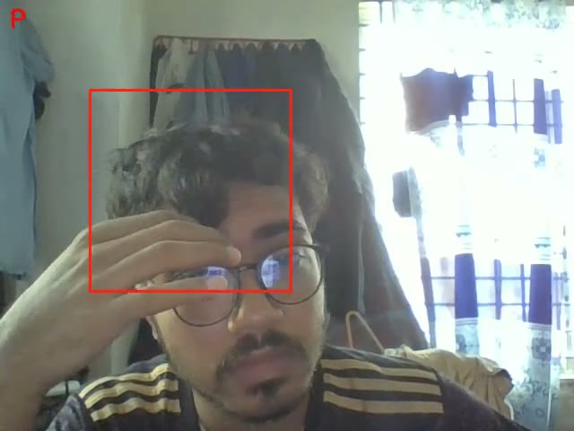
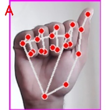
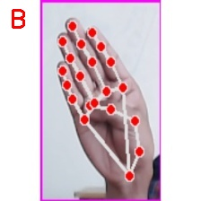
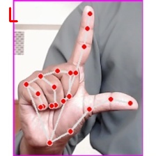
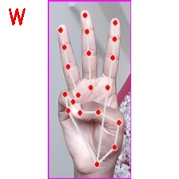
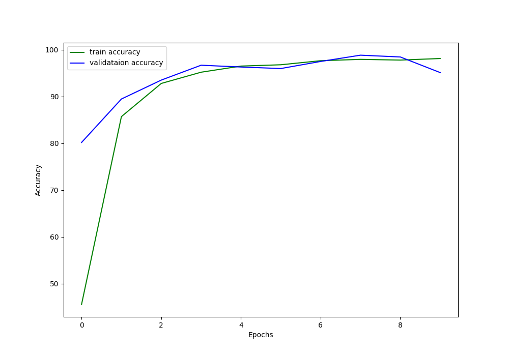
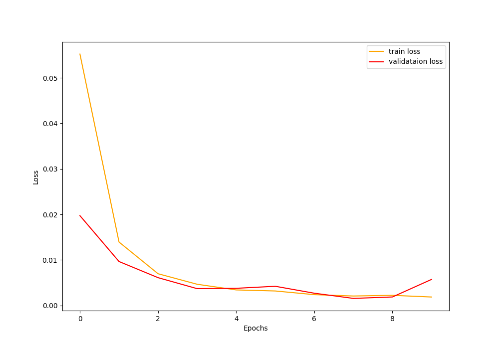

# Sign Language Detection

Reads American Sign Language letters from a camera, with a convolutional
neural network in PyTorch and, in one of its scripts, MediaPipe hand
tracking. Built in May 2023 as a course project at Comilla University.

<a href="docs/media/asl-detection-2023-05-22-live-camera-test.mp4"></a><br>
The live camera test of May 2023, from `predict_camera.py`: the model labels whatever is inside
the red box on every frame, so many of its readings are wrong ([video](docs/media/asl-detection-2023-05-22-live-camera-test.mp4), 74 s).

|  |  |  |  |
|:---:|:---:|:---:|:---:|
| A | B | L | W |

More results, for 22 letters, are in [`docs/media/results/`](docs/media/results);
on `n1.jpg` the model read the N as T.

## How it works

1. [`preprocess_image.py`](src/preprocess_image.py) picks images of each
   sign from `data/train/<class>/` and resizes them to 224 × 224.
2. [`create_csv.py`](src/create_csv.py) labels them and saves the label
   encoder.
3. [`train.py`](src/train.py) trains the CNN in [`cnn_models.py`](src/cnn_models.py)
   (Adam, batch 32, an 85/15 train and validation split) and saves the
   model and the two plots below.
4. Three scripts use the model:
   - [`predict_image.py`](src/predict_image.py) reads one image;
   - [`predict_camera.py`](src/predict_camera.py) reads a fixed box in the
     webcam's view;
   - [`predict_hand_tracking.py`](src/predict_hand_tracking.py) finds the
     hand with MediaPipe first, then reads it.

The trained model in [`assets/models/`](assets/models) has 29 output
classes. Their names were saved in `lb.pkl`, which is not in the
repository.

| Accuracy | Loss |
|:---:|:---:|
|  |  |

The plots are from the training run, not from a separate test set.

## Repository layout

| Folder | Holds |
|---|---|
| [`src/`](src) | The scripts above, plus [`data_collection.py`](src/data_collection.py) for taking new hand images and the hand detector they share |
| [`assets/models/`](assets/models) | The trained model, `model.pth` |
| [`docs/`](docs) | The report's flow chart and system design (designed; the code differs), and in [`media/`](docs/media) the video, the plots and the results |
| `data/` | The training images, not included: put them in `data/train/<class>/` and test images in `data/test/` |

## Run it

It ran with PyTorch in 2023. Install PyTorch, torchvision, OpenCV,
albumentations, imutils, scikit-learn, pandas, joblib, matplotlib, tqdm
and MediaPipe, then:

```bash
python src/preprocess_image.py --num-images 800
python src/create_csv.py
python src/train.py --epochs 10
python src/predict_camera.py
```

`create_csv.py` writes the label binarizer, `assets/models/lb.pkl`, which
every other script loads (`cnn_models.py` loads it on import). It is not in
the repository, and the included model's 29 class names were never
recorded, so to use the scripts, train on your own data with steps 1 to 3.
`predict_hand_tracking.py` also needs TensorFlow, because it imports
cvzone's unused Keras classifier. The camera scripts open camera 2: change the
index in the script if yours differs.

## The team

Group-A built it for a course at Comilla University and wrote it up in a
project report: Niaz Al Masum, Sweety Akter, Md. Sumon Mia, Akash Hasnat
and me, guided by Alimul Rajee. I put this repository together.

It stands on others' work:

- Data preparation, the CNN, training, `predict_image.py` and
  `predict_camera.py` are adapted from Sovit Ranjan Rath's tutorial
  [American Sign Language Recognition using Deep Learning](https://debuggercafe.com/american-sign-language-recognition-using-deep-learning/)
  (DebuggerCafe, 2020).
- The hand detector and the image classifier are adapted from
  [cvzone](https://github.com/cvzone/cvzone) (MIT).

## Licence

The rest of the code is under the MIT licence: see [LICENSE](LICENSE).
cvzone's files keep its MIT licence, in
[`LICENSES/cvzone.txt`](LICENSES/cvzone.txt), and the parts adapted from the DebuggerCafe tutorial,
which states no open licence, stay its author's.
